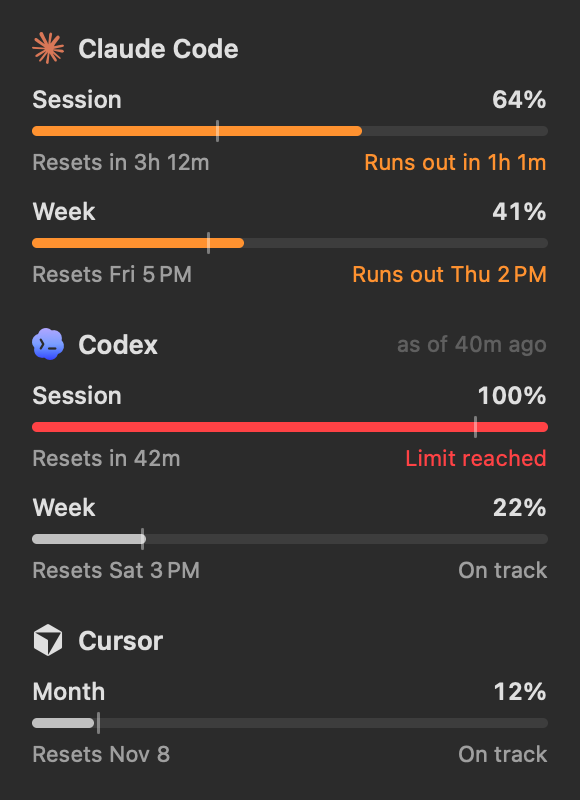

# Pace

A macOS menu bar app and desktop widget that shows your Claude Code, Codex and Cursor usage, when each limit resets, and whether you're on pace to make it to the reset.



## What it shows

Each provider shows its limit windows: Claude Code's 5-hour session and weekly limit, Codex's windows (weekly on Pro), and Cursor's billing month. Every bar has a tick at the point where usage would be if you spread it evenly across the window. Fill past the tick means you're ahead of that pace.

Pace projects your current burn rate to the reset:

- **On track**: you'll land under the limit.
- **Runs out in 2h 10m** (orange): at this rate you hit the limit before the reset.
- **Limit reached** (red).

The menu bar shows each provider's icon and the percentage of its tightest window. A number turns orange or red when that provider is off pace.

Left click opens the details. Right click has Refresh, Open at Login and Quit.

## Where the numbers come from

Pace reads the sign-ins the CLIs already keep on your Mac and asks the same endpoints the tools use for their own usage screens. It never writes to their credentials.

| Provider | Sign-in | Endpoint |
| --- | --- | --- |
| Claude Code | `Claude Code-credentials` keychain item (read through `/usr/bin/security`), or `~/.claude/.credentials.json` | `api.anthropic.com/api/oauth/usage` |
| Codex | `~/.codex/auth.json` (or `$CODEX_HOME`) | `chatgpt.com/backend-api/wham/usage`, falling back to the rate limits Codex logs in `~/.codex/sessions` |
| Cursor | `cursorAuth/accessToken` in Cursor's `state.vscdb` | `cursor.com/api/usage-summary` |

A provider that isn't installed or signed in is hidden. Usage refreshes every 2 minutes, on wake, and when you open the popover. If Claude Code's token has expired, opening Claude Code refreshes it.

## Widget

Right click the desktop, choose Edit Widgets, search for Pace and add Usage in small, medium or large. The widget reads what the app last fetched from a shared app group container, so the app needs to be running. It opens at login by default.

## Build

Requires Xcode 16 or later and [XcodeGen](https://github.com/yonaskolb/XcodeGen).

```sh
scripts/install.sh
```

The project signs with the `Apple Development` identity for team `4535Q45QTY`. To build under your own team, change `DEVELOPMENT_TEAM` in `project.yml`. The app group is derived from the team ID.

`Pace --render <dir> [--sample]` writes PNGs of the menu bar label, popover and every widget size, in light and dark, using live data or a sample that covers every state.

The provider icons are from [Lobe Icons](https://github.com/lobehub/lobe-icons). The marks belong to Anthropic, OpenAI and Anysphere.
