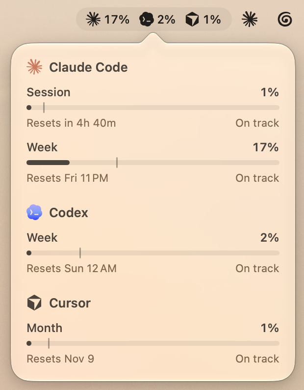

# Pace

Claude Code, Codex and Cursor usage in your Mac menu bar and as a desktop widget. Shows when each limit resets and whether you're on track to make it there.



The tick on each bar is where your usage would be at an even pace. If your current rate would hit the limit before the reset, the row turns orange and says when you'll run out. Codex's free full resets are listed with their expiry dates.

Pace reads the sign-ins Claude Code, Codex and Cursor already keep on your Mac and asks the same endpoints those tools use for their own usage pages. It refreshes every minute and never touches their credentials. Right-click the menu bar item to turn providers on or off.

## Install

Needs macOS 14, Xcode and [XcodeGen](https://github.com/yonaskolb/XcodeGen). Set `DEVELOPMENT_TEAM` in `project.yml` to your Apple team ID, then:

```sh
scripts/install.sh
```

Add the widget from the desktop with Edit Widgets.
